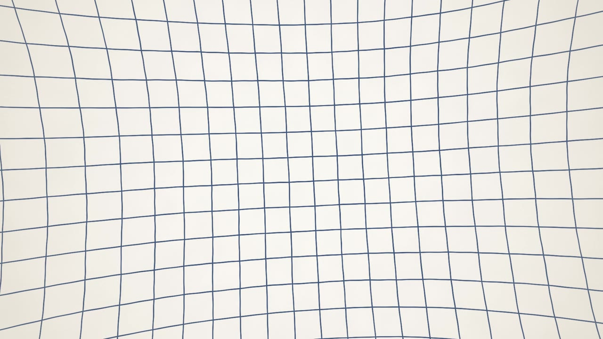

# Karopapier – Motion-Graphics-Hintergrund

Bewegter Hintergrund (Template) für Videos: helles, handgezeichnetes **Karopapier**
(dunkelblaue Linien auf cremeweißem Papier), das wie durch eine Linse **nach außen gewölbt**
ist und sich ruhig und fließend bewegt.

▶️ **Video:** [`output/karopapier_hintergrund_50s.mp4`](output/karopapier_hintergrund_50s.mp4)



| | |
|---|---|
| Länge | 50 Sekunden, **nahtlos loopbar** (letztes Bild geht direkt ins erste über) |
| Format | 1920 × 1080, 25 fps, H.264 (MP4), ohne Ton |
| Farben | Papier `#F9F6F1`, Linien `#304A74` |

## Die Bewegung

- **Linsenwölbung**: Die Mitte wirkt nach vorne gewölbt, die Kästchen am Rand werden größer und
  die Linien biegen sich nach außen. Die Wölbung „atmet“ zweimal pro Loop und die Linsenmitte
  wandert langsam.
- **Gleiten**: Das Papier zieht stetig schräg durchs Bild, mit einer weichen Schwingung.
- **Drehung & Zoom**: leicht hin und her (ca. ±3°, ±6 %).
- **Flüssige Welle**: eine sanfte, wandernde Welle lässt die Linien leicht schwimmen.
- **Handgezeichnet**: jede Linie hat kleine Unregelmäßigkeiten, die Strichstärke schwankt leicht
  wie bei einem Fineliner, dazu feine Papiermaserung und eine leichte Vignette.

## Selbst rendern / anpassen

```bash
pip install numpy pillow        # ffmpeg muss installiert sein
python make_video.py            # volles Video nach output/
python make_video.py --preview  # schnelle Vorschau (960x540, 10 s) nach build/
python make_video.py --still 12.5               # Einzelbild als PNG
python make_video.py --width 3840 --height 2160 --out output/karopapier_4k.mp4   # 4K
```

Farben, Kästchengröße (`CELL`), Strichstärke (`LINE`) und die Bewegung (`motion()`) stehen oben
in [`make_video.py`](make_video.py). Damit der Loop nahtlos bleibt, in `motion()` nur ganzzahlige
Vielfache von `th` verwenden.
