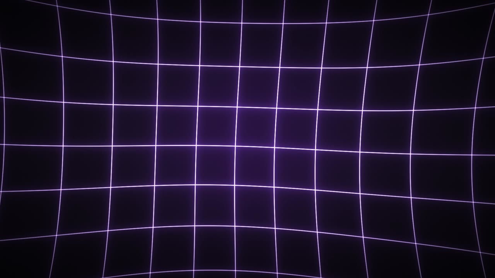

# Lila Gitter – Motion-Graphics-Hintergrund

Bewegter, dunkler Hintergrund (Template) für Videos: ein **leuchtendes Gitter**, das wie durch
eine Linse **nach außen gewölbt** ist, mit **lila Note**. Die Linien sind lavendelweiß mit
violettem Glow, der Hintergrund ist dunkles Violett-Schwarz, die Mitte hell und die Ecken
verlaufen ins Schwarze.

▶️ **Video:** [`output/lila_gitter_hintergrund_50s.mp4`](output/lila_gitter_hintergrund_50s.mp4)



| | |
|---|---|
| Länge | 50 Sekunden, **nahtlos loopbar** (letztes Bild geht direkt ins erste über) |
| Format | 1920 × 1080, 25 fps, H.264 (MP4), ohne Ton |
| Farben | Hintergrund `#191224`, Linien `#EEE2FF`, Glow `#965CFF` ↔ `#CD5CF5` |

## Die Bewegung

Gleiche Bewegung wie beim [Karopapier-Hintergrund](../karopapier-hintergrund/) (schnellere Version):

- **Linsenwölbung**, die dreimal pro Loop „atmet“, und eine langsam wandernde Linsenmitte
- **Gleiten**: Das Gitter zieht stetig schräg durchs Bild (12 × 6 Kästchen pro Loop), mit weicher Schwingung
- **Drehung & Zoom**: leicht hin und her (ca. ±3°, ±6 %)
- **Flüssige Welle**: eine sanfte, wandernde Welle lässt die Linien leicht schwimmen
- **Farbe**: Der Glow pendelt langsam zwischen Violett und Lila-Pink, das Licht in der Mitte pulsiert leicht

## Selbst rendern / anpassen

```bash
pip install numpy pillow        # ffmpeg muss installiert sein
python make_video.py            # volles Video nach output/
python make_video.py --preview  # schnelle Vorschau (960x540, 10 s) nach build/
python make_video.py --still 12.5               # Einzelbild als PNG
python make_video.py --width 3840 --height 2160 --out output/lila_gitter_4k.mp4   # 4K
```

Farben (`BG`, `CORE`, `GLOW_A`, `GLOW_B`), Kästchengröße (`CELL`), Glow (`BLOOM`, `HALO`) und die
Bewegung (`motion()`) stehen oben in [`make_video.py`](make_video.py). Damit der Loop nahtlos
bleibt, in `motion()` nur ganzzahlige Vielfache von `th` verwenden.
